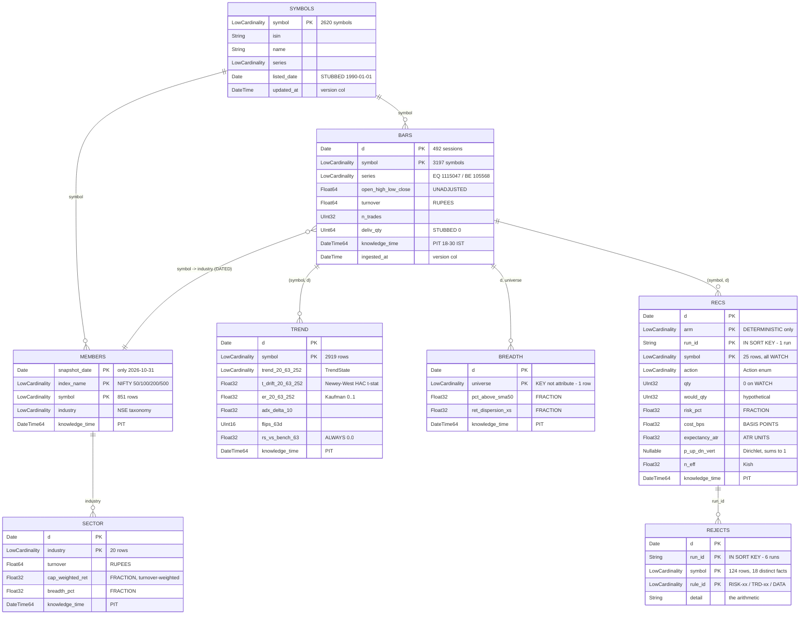
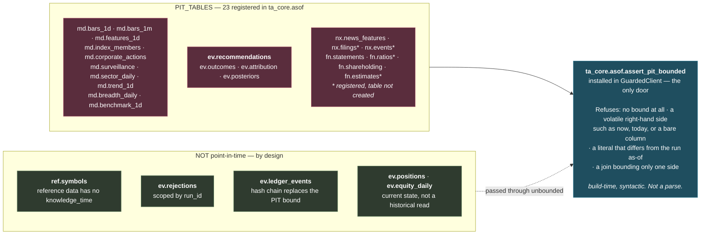

# ClickHouse schema — ER view

ClickHouse has no foreign keys; these are the **join keys the code actually uses**. Row counts are
live as of 2026-10-31. Full column documentation is in [../DATA_MODEL.md](../DATA_MODEL.md).

---

## Populated today

The five tables the nightly run writes, plus the two reference tables it reads.

---

## Specified and empty

Everything below exists as a table with zero rows and, in most cases, no writer.

```mermaid
erDiagram
    RECS_X ||--o| OUTCOMES : "rec_id"
    OUTCOMES ||--o{ ATTRIB : "rec_id x reason_code"
    ATTRIB ||--o{ POSTERIORS : "reason_code, regime, horizon"
    LEDGER ||--o{ POSITIONS : "rebuild_from_ledger()"
    POSITIONS ||--o{ EQUITY : "daily mark"
    BARS_X ||--o{ FEATURES : "(symbol, d)"
    BARS_X ||--o{ CORPACT : "symbol, ex_date"
    BARS_X ||--o{ SURV : "(symbol, d)"
    SYMBOLS_X ||--o{ NEWS : "symbol"
    SYMBOLS_X ||--o{ STMTS : "symbol, period_end"
    SYMBOLS_X ||--o{ SHARE : "symbol, period_end"

    RECS_X {
        String rec_id PK "ev.recommendations - POPULATED"
    }
    BARS_X {
        String symbol_d PK "md.bars_1d - POPULATED"
    }
    SYMBOLS_X {
        String symbol PK "ref.symbols - POPULATED"
    }

    OUTCOMES {
        String rec_id PK "0 rows - blocks calibration (needs 30)"
        LowCardinality barrier_hit "UP DOWN VERTICAL CANCELLED OPEN"
        Float32 r_multiple
        Float32 calibrated_p "sizing uses THIS, never stated_conf"
        Float32 uniqueness_w "1/overlapping labels"
        UInt8 degraded_mode
    }
    ATTRIB {
        LowCardinality reason_code PK "0 rows - ONE ROW PER CODE"
        Date resolved_date PK
        String rec_id PK
        Float32 weight
    }
    POSTERIORS {
        Date as_of PK "0 rows"
        LowCardinality reason_code PK
        Float64 alpha_beta "Beta-Binomial"
        UInt8 gated "n_eff >= 30 before touching sizing"
    }
    LEDGER {
        UInt64 seq PK "0 rows - NO WRITER"
        String payload "canonical JSON, never pickle"
        String prev_hash "hash chain"
        String hash
    }
    POSITIONS {
        LowCardinality symbol PK "0 rows - API returns a flat book"
        Date opened PK
        Float64 stop "heat uses CURRENT stop"
        LowCardinality status "OPEN"
    }
    EQUITY {
        LowCardinality arm PK "0 rows - blocks sim (needs 750 days)"
        Date d PK
        Float32 drawdown
    }
    FEATURES {
        Date d PK "0 rows - factors are in-memory only"
        LowCardinality symbol PK
    }
    CORPACT {
        LowCardinality symbol PK "0 rows - LEAKAGE VECTOR 3 IS LIVE"
        Date ex_date PK
        Float64 adj_factor
    }
    SURV {
        Date d PK "0 rows - ASM/GSM NOT excluded"
        LowCardinality symbol PK
        LowCardinality list_type "ASM GSM ESM T2T BAN"
    }
    NEWS {
        DateTime64 ts PK "0 rows - M7. DISSEMINATION time"
        LowCardinality symbol PK
        Int32 latency_sec
    }
    STMTS {
        LowCardinality symbol PK "0 rows - M7"
        Date period_end PK
        UInt8 consolidated PK "in sort key: never mix with standalone"
        DateTime64 filed_at "when it became PUBLIC"
    }
    SHARE {
        LowCardinality symbol PK "0 rows - M7"
        Date period_end PK
        Float32 promoter_pledge "distress signal"
    }
```

Also empty: `md.bars_1m` (minute bars, M10), `md.benchmark_1d` (NIFTY 50 TRI — **nothing to
benchmark the equity curve against**).

---

## Engines and sort keys

| Table | Engine | Partition | Sort key | Rows |
| --- | --- | --- | --- | ---: |
| `md.bars_1d` | `ReplacingMergeTree(ingested_at)` | `toYYYYMM(d)` | `(symbol, d)` | 1,220,615 |
| `md.bars_1m` | `ReplacingMergeTree` | `toYYYYMM(ts)` | `(symbol, ts)` | 0 |
| `md.index_members` | `ReplacingMergeTree` | `toYear(snapshot_date)` | `(index_name, snapshot_date, symbol)` | 851 |
| `md.corporate_actions` | `ReplacingMergeTree` | — | `(symbol, ex_date, action_type)` | 0 |
| `md.surveillance` | `ReplacingMergeTree` | `toYYYYMM(d)` | `(d, symbol, list_type)` | 0 |
| `md.features_1d` | `ReplacingMergeTree` | `toYYYYMM(d)` | `(symbol, d)` | 0 |
| `md.sector_daily` | `ReplacingMergeTree` | `toYear(d)` | `(d, industry)` | 20 |
| `md.trend_1d` | `ReplacingMergeTree` | `toYYYYMM(d)` | `(symbol, d)` | 2,919 |
| `md.breadth_daily` | `ReplacingMergeTree` | — | `(d, universe)` | 1 |
| `md.benchmark_1d` | `ReplacingMergeTree` | — | `(index_id, series_kind, d)` | 0 |
| `nx.news_features` | `ReplacingMergeTree` | `toYYYYMM(ts)` | `(symbol, ts, doc_id)` | 0 |
| `fn.statements` | `ReplacingMergeTree` | — | `(symbol, period_end, consolidated)` | 0 |
| `fn.shareholding` | `ReplacingMergeTree` | — | `(symbol, period_end)` | 0 |
| **`ev.recommendations`** | **`MergeTree`** | `toYYYYMM(d)` | **`(d, arm, run_id, symbol)`** | 25 |
| **`ev.rejections`** | **`MergeTree`** | `toYYYYMM(d)` | **`(d, run_id, symbol, rule_id)`** | 124 |
| `ev.ledger_events` | `ReplacingMergeTree` | — | `seq` | 0 |
| `ev.positions` | `ReplacingMergeTree(as_of)` | — | `(symbol, opened)` | 0 |
| `ev.equity_daily` | `ReplacingMergeTree` | — | `(arm, d)` | 0 |
| `ev.outcomes` | `ReplacingMergeTree` | — | `(rec_id)` | 0 |
| `ev.attribution` | `ReplacingMergeTree` | — | `(reason_code, resolved_date, rec_id)` | 0 |
| `ev.posteriors` | `ReplacingMergeTree` | — | `(as_of, reason_code, regime, horizon)` | 0 |
| `ref.symbols` | `ReplacingMergeTree(updated_at)` | — | `symbol` | 2,620 |

### The two deliberate `MergeTree` exceptions

`ev.recommendations` and `ev.rejections` were **changed from `ReplacingMergeTree` to `MergeTree`,
with `run_id` added to the sort key.**

Under `ReplacingMergeTree ORDER BY (d, arm, symbol)`, re-running the nightly job for the same
session produced rows with an identical sort key, so the previous run's recommendation for a symbol
was **destroyed by the act of recommending that symbol again**. The table whose entire purpose is
*"what did the system recommend on this date"* was erased by normal operation — silently, with no
error, always appearing to show the correct latest state.

That matters beyond tidiness: the learning loop scores what the system said **at the time**. A
corrected re-run silently overwriting the original means a bad call can be edited out of history
after the fact, which makes every downstream statistic unfalsifiable.

**The cost you now carry:** append-only means every reader must pin a run.
`apps/api._latest_run()` does this for `/api/screener` and `/api/recommendations`.
**`/api/rejections` does not**, which is why it currently returns all 124 rows from six separate
runs — only 18 distinct `(symbol, rule_id)` facts, some repeated ten times. `MergeTree` is
append-only by design, so no background merge will ever tidy this up.

### Why `(symbol, d)` and not `(d, symbol)` on `md.bars_1d`

Every read in the system is "this symbol's trailing window" or "the whole panel over a date range,
sorted by symbol". Symbol-major keeps one symbol's history contiguous on disk, which is exactly
what the factor stack scans.

---

## Point-in-time membership

**`ev.recommendations` is in `PIT_TABLES`, and the reason is non-obvious.** From `asof.py`:

> A past recommendation must be served exactly as it was recorded. Putting it behind the PIT guard
> is what stops an endpoint from "helpfully" recomputing a probability with data that arrived after
> the decision.

**Adding a table with a `knowledge_time` column fails the build until you register it.**
`tests/pit/test_guard_hardening.py::test_every_pit_table_in_the_schema_is_registered_in_the_guard`
parses `infra/clickhouse/schema*.sql`, collects every `CREATE TABLE` whose body declares
`knowledge_time`, and asserts the set is a subset of `PIT_TABLES`. The schema is the source of
truth; the Python constant must follow it.

---

## Storage, measured

| Table | Rows | Parts | On disk | Uncompressed | Ratio |
| --- | ---: | ---: | ---: | ---: | ---: |
| `md.bars_1d` | 1,220,615 | 24 | **35.40 MiB** | 123.85 MiB | **3.59×** |
| `md.trend_1d` | 2,919 | 1 | 150.13 KiB | 169.57 KiB | 1.38× |
| `ref.symbols` | 2,620 | 1 | 92.64 KiB | 183.23 KiB | 2.19× |
| `md.index_members` | 851 | 1 | 26.98 KiB | 57.82 KiB | 2.77× |
| `ev.rejections` | 124 | 2 | 5.85 KiB | 9.35 KiB | 4.46× |
| `ev.recommendations` | 25 | 1 | 16.60 KiB | 13.43 KiB | 2.28× |
| `md.sector_daily` | 20 | 1 | 5.53 KiB | 1.25 KiB | 0.93× |
| `md.breadth_daily` | 1 | 1 | 2.71 KiB | 75 B | 0.23× |

Whole `data/clickhouse/` directory: **37 MB**.

**Use 3.59× when sizing**, not HANDOFF.md's 5.3× (derived from an assumed bytes-per-row) and not
the 10–15× commonly quoted. Sub-1.0 ratios on the tiny tables are header and index overhead on
3-row parts, not anomalies.

**Multi-part Replacing tables are the duplicate hazard, and it is intermittent.** Earlier in this
session `md.sector_daily`, `md.breadth_daily`, `md.trend_1d` and `ref.symbols` each sat on 3
unmerged parts — one per nightly run — and readers that do not dedupe saw every version. A
background merge has since collapsed all four to 1 part, hiding the symptom while the code is
unchanged. **Every row count on a Replacing table is merge-state dependent**, so do not treat one
observation as the shape of the data. See [../API.md](../API.md#known-defects-collected) and
[../OPERATIONS.md §6.9](../OPERATIONS.md#69-the-dashboard-shows-duplicate-rows).
