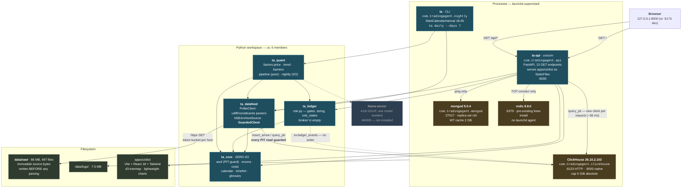

# C4 level 2 — containers

Processes, Python packages, datastores and the edges between them. Dashed = specified but not
built.

## Reading this

**`ta_core` is at the bottom of every arrow and sends none.** It has zero I/O — stdlib plus
pydantic, nothing that opens a socket, reads a file or touches a database. That is what lets the
whole domain layer be tested with no services running: `uv run --frozen pytest` is green on a
machine with ClickHouse down.

**`GuardedClient` is the only door into ClickHouse**, and the point-in-time guard is installed
there rather than left to each caller. Both `ta_quant.nightly` and `apps/api` go through it; a
`query_admin` escape hatch exists for operational questions and a CI test greps to ensure it never
appears in decision code.

**`packages/llm` and `packages/news` do not exist.** `packages/ledger` contains `risk.py` only —
no hash-chained event ledger, no paper broker, so `ev.ledger_events`, `ev.positions`, `ev.outcomes`
and `ev.equity_daily` all have zero rows and no writer.

**Redis and MongoDB are load-bearing only on the health panel.** Mongo holds zero application
documents (only `admin`, `config`, `local`); Redis has no Python client in the lock file. The token
bucket that does exist is in-process (`threading.Lock` in `ta_datafeed.http`). Both are running,
configured and capped — ready, not used.

**There is no orchestrator process.** PLAN.md names Prefect 3.9; it is not in `uv.lock`. Scheduling
is one launchd `StartCalendarInterval`.

## Process lifecycle

| Container | Managed by | Restart policy |
| --- | --- | --- |
| ClickHouse | `com.tradingagent.clickhouse` | `RunAtLoad`, `KeepAlive=true` |
| mongod | `com.tradingagent.mongod` | `RunAtLoad`, `KeepAlive=true` |
| ta-api | `com.tradingagent.api` | `RunAtLoad`, `KeepAlive={SuccessfulExit:false}`, `ThrottleInterval=10` — restart on crash, **not** in a tight loop if it cannot bind |
| nightly | `com.tradingagent.nightly` | calendar only, `RunAtLoad=false`, `ExitTimeOut=1800`, `ProcessType=Background`, `LowPriorityIO` |
| redis | nothing | assumed running from `brew services` |

All four agents invoke absolute paths (`/opt/homebrew/bin/uv`, `infra/bin/clickhouse`) because
**launchd execs without a shell** — no PATH, no venv activation, no profile.
