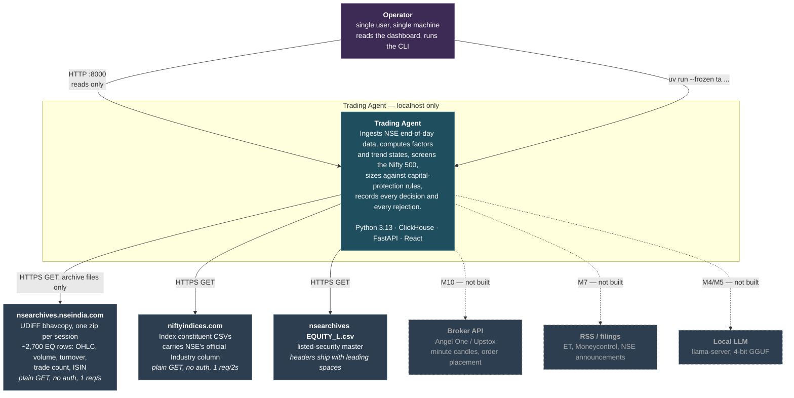

# C4 level 1 — system context

Who uses the system and what it reaches outside itself. Everything inside the dashed box runs on
one laptop; nothing listens on a non-loopback interface.

## What is deliberate here

**Three HTTP sources, all unauthenticated, all published archive files.** `www.nseindia.com`
returns 403 to non-browser clients and `query1.finance.yahoo.com` returned 429 from this machine.
The design routes **around** both rather than through them: no cookie-warming, no session
emulation, no bot-protection defeat. NSE's Terms of Use prohibit systematic automated collection,
and fetching a published CSV is a materially different act from emulating a browser to reach an
internal JSON API.

**No egress except those three hosts.** No telemetry (`DO_NOT_TRACK=1` and
`PREFECT_SERVER_ANALYTICS_ENABLED=false` are set in the launchd plists), no cloud services, no
model APIs, no account anywhere. The entire M1 deliverable runs on **two unauthenticated GETs per
day**.

**One user, no auth, loopback only.** ClickHouse (8123/9000), mongod (27017), redis (6379) and
uvicorn (8000) all bind `127.0.0.1`. There is no authentication on any of them. This is a
single-user personal system and is not designed for scale — see
[../OPERATIONS.md §9](../OPERATIONS.md#9-security-posture).

**The dashed arrows are the honest part.** A broker adapter, a news pipeline and an LLM layer are
all specified in `docs/PLAN.md` and none exists. The system today is a deterministic screener with
an audit trail.
