# Data flow — NSE archive to dashboard

One bhavcopy's journey, and where each transformation adds or protects meaning.

```mermaid
flowchart TD
    A["<b>nsearchives.nseindia.com</b><br/>BhavCopy_NSE_CM_0_0_0_<b>20261030</b>_F_0000.csv.zip<br/>~203 KB zipped / 636 KB CSV · 3,698 rows"]

    B["<b>PoliteClient.get_bytes</b><br/>token bucket 1 req/s<br/>reuse=True (a past bhavcopy never changes)<br/>404 => was_session=False, not an error"]

    C["<b>data/raw/nse_bhavcopy/2026/10/</b><br/>filename = first 16 hex of sha256 of the URL<br/>+ the original basename<br/><i>bytes land BEFORE any parsing</i><br/>497 files · 86 MB"]

    D["<b>parse_udiff_bhavcopy</b><br/>columns by NAME, never position<br/>filter SctySrs in (EQ, BE)<br/>missing required column => hard error"]

    E["<b>knowledge_time = 18:30 IST on d, in UTC</b><br/>not the trade date, not the fetch time"]

    F[("<b>md.bars_1d</b><br/>ReplacingMergeTree(ingested_at)<br/>ORDER BY (symbol, d)<br/>1,220,615 rows · 3,197 syms · 492 sessions<br/>35.40 MiB on disk · 3.59x compression")]

    G["<b>niftyindices.com</b><br/>ind_nifty{50,100,200,500}list.csv<br/>Company Name, <b>Industry</b>, Symbol, Series, ISIN"]
    H["<b>parse_constituents</b><br/>reuse=FALSE, archive=TRUE<br/>day-granular dir"]
    I[("<b>md.index_members</b><br/>DATED snapshots, 851 rows<br/>ORDER BY (index_name, snapshot_date, symbol)")]

    J["<b>load_panel_inputs(ch, d, as_of)</b><br/>query_pit — knowledge_time <= literal<br/>420 sessions lookback<br/><b>dedupe (symbol,d) in polars</b>"]

    K["<b>build_panel</b><br/>add_price_factors — 20 factors, trailing windows only<br/>add_trend_states — HAC t-stat, ER, ADX delta, hysteresis<br/>⋈ dated industry label"]

    L["<b>sector_aggregates</b><br/>turnover-weighted return<br/>drop Unclassified"]
    M["<b>breadth_row</b> => <b>infer_regime</b><br/>4 thresholds, stated as a heuristic"]
    N["<b>score_universe</b><br/>composite z-scored <b>WITHIN industry</b><br/>0.30 mom + 0.20 med + 0.25 rs + 0.15 adx + 0.10 lowvol"]
    O["<b>build_path_library</b> ONCE<br/>real forward paths, ATR-standardised<br/>k_up=2.0 k_dn=1.5 == live geometry<br/>same-bar tie => DOWN"]

    P["<b>evaluate_entry(pf, cand, regime)</b><br/>14 ordered checks<br/><b>pf grows as cards are accepted</b>"]
    Q["<b>compute_costs</b> on the ACTUAL notional<br/>STT both legs · stamp duty buy only<br/>flat Rs 15.34 DP charge"]
    R["<b>estimate_barriers</b><br/>one Dirichlet, triad sums to 1<br/>Kish n_eff < 200 => UNAVAILABLE"]
    S{"E = 2.0·p_up minus 1.5·p_dn minus cost_atr<br/><b>at least 0.05 ATR?</b>"}
    T["<b>BUY</b><br/>qty > 0 · book grows"]
    U["<b>WATCH</b><br/>qty = 0 · would_qty kept<br/>'no demonstrated edge' + arithmetic"]

    V[("<b>md.sector_daily</b> 20")]
    W[("<b>md.breadth_daily</b> 1")]
    X[("<b>md.trend_1d</b> 2,919")]
    Y[("<b>ev.recommendations</b> 25<br/><b>MergeTree</b>, run_id in sort key")]
    Z[("<b>ev.rejections</b> 124<br/><b>MergeTree</b>, run_id in sort key")]

    AA["<b>FastAPI</b> — one PIT-bounded SELECT per endpoint<br/><i>the API computes nothing</i>"]
    AB["<b>React SPA</b> :8000<br/>d3 treemap · lightweight-charts<br/>em-dash for UNAVAILABLE · lakh grouping"]

    A --> B --> C --> D --> E --> F
    G --> H --> I
    F --> J
    I --> J
    J --> K
    K --> L --> V
    K --> M --> W
    K --> N
    K --> O
    N --> P
    M --> P
    P -->|rejected| Z
    P -->|allowed| Q --> R --> S
    O --> R
    S -->|yes| T --> Y
    S -->|no| U --> Y
    K --> X
    V --> AA
    W --> AA
    X --> AA
    Y --> AA
    Z --> AA
    AA --> AB

    classDef src fill:#2c3e50,stroke:#4a6572,color:#fff
    classDef proc fill:#1f4e5f,stroke:#2d7a94,color:#fff
    classDef store fill:#4a3c1f,stroke:#8a7230,color:#fff
    classDef guard fill:#5a2d3d,stroke:#a04a63,color:#fff
    classDef out fill:#2f3b2f,stroke:#5a7a5a,color:#fff
    class A,G src
    class B,D,H,J,K,L,M,N,O,P,Q,R,AA proc
    class F,I,V,W,X,Y,Z store
    class C,E guard
    class T,U,AB out
```

## The five points where meaning is created or protected

### 1. Raw bytes land before parsing — `data/raw/`

Governing principle 3. If the parser has a bug — and it will, NSE changes CSV headers without
notice — the fix is a **re-parse**, not 497 HTTPS requests to an exchange whose Terms of Use
prohibit systematic collection. Everything downstream is reconstructible from this directory, and
it is the one thing in the repo that cannot be regenerated.

`reuse` and `archive` are **separate knobs**, and conflating them loses data. A bhavcopy is reused
and archived. An index constituent list is **never reused** (NSE overwrites it) but is **always
archived** — otherwise the dated membership snapshot is gone forever the moment NSE updates the
file. The principle is *raw bytes are immutable*, not *raw bytes are cached*.

### 2. `knowledge_time` is stamped at parse, not at read

`18:30 IST on the session date`, converted to UTC. A decision at 15:00 IST on 2026-10-29 cannot
see a file that lands at 18:30 that evening. Every downstream read carries
`knowledge_time <= <literal>` and the guard refuses anything else — including `now()`, which
passed the first version of the guard and read the future.

### 3. Dedupe on read, not on merge

`ReplacingMergeTree` collapses duplicates only on an **unscheduled background merge**. Re-ingesting
a session leaves two rows for `(symbol, d)` until then — and every rolling window in the factor
stack (SMA, ATR, RSI, ADX, the HAC autocovariances, 52-week extremes) is computed by **row
position** within `over("symbol")`, not by date. One duplicate shifts all of them. SMA20 silently
becomes a 20-row average of 19 distinct sessions. Nothing errors; the values stay plausible.

`md.bars_1d` currently sits on **24 active parts** with zero live duplicates — exactly the state
that makes this easy to re-introduce.

### 4. The barrier library is built once, with the live geometry

`k_up=2.0, k_dn=1.5` are bound at module scope to `TARGET_ATR` and `STOP_ATR`, the same constants
that write the card's target and stop. An earlier version measured P(touch −1.0 ATR) while placing
the stop at −1.5 ATR, which overstated `p_dn` enough to make **every** candidate look
negative-expectancy. The geometry is also printed into `barrier.reason` so a future drift is
visible in the recorded row.

### 5. Candidates are gated against a growing book

`pf` is rebuilt after every accepted BUY. Against a constant starting portfolio, `RISK-04` (heat),
`RISK-05` (count, cash), `RISK-06` (industry) and `RISK-08` (correlation) are all functions of an
empty book and **none of them ever bind** — which is how a screener emits 25 cards that jointly
breach every cap it claims to enforce, each internally consistent, with the risk panel showing
green because it evaluates the *actual* (empty) book.

A **WATCH card does not grow the book.** It advises nothing and consumes no capital, so letting it
consume headroom would starve genuinely actionable candidates further down the ranking.

## Volumes, measured

| Stage | Size |
| --- | --- |
| one bhavcopy, zipped | ~203 KB |
| one bhavcopy, CSV | ~636 KB, 3,698 rows (~2,712 EQ) |
| `data/raw/` total | **86 MB · 497 files** |
| `md.bars_1d` uncompressed | 129.87 MB |
| `md.bars_1d` on disk | **35.40 MiB** (3.59× compression) |
| whole ClickHouse directory | 37 MB |
| one night's outputs | 25 recs + 18 rejections + 20 sector + 1 breadth + 2,919 trend rows |
| ClickHouse-side heatmap query | **2.64 ms** for 40 rows |
| end-to-end `/api/heatmap` | **p50 47.9 ms / p95 58.0 ms** — ~38 ms of it is per-request client construction |

Two years of full-market EOD costs 35 MiB. Ten years is ~180 MiB. The 5 GiB ClickHouse cap is not
a constraint on this data; it exists to protect the LLM's headroom.
