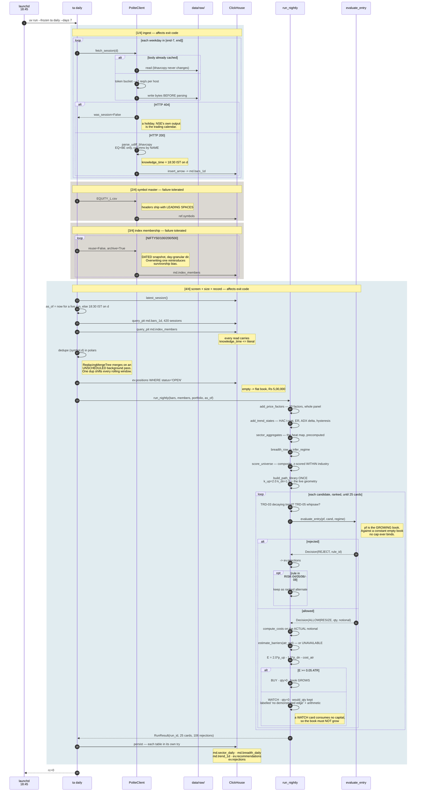

# The nightly run

`ta daily --days 7`, fired by `com.tradingagent.nightly` at **18:45 local**. Four stages. Typical
incremental runtime **~10 s**.



## Stages and failure behaviour

| Stage | Writes | Failure |
| --- | --- | --- |
| `[1/4] ingest` | `md.bars_1d` | **non-zero exit** |
| `[2/4] symbol master` | `ref.symbols` | logged, run continues |
| `[3/4] index membership` | `md.index_members` | logged, run continues |
| `[4/4] screen + record` | 5 tables | **non-zero exit** |

Each stage is independent and a failure is reported rather than raised: *a missing constituents
refresh must not cost you the day's bars, and a screen that fails must not hide the fact that
ingestion succeeded.* The exit code tracks the screen because that is the stage whose silence
would otherwise look like "no trades today".

`persist` wraps each table write in its own `try` for the same reason — *a missing heat map is
better than a missing run.*

## What the live run actually produces

Session 2026-10-30, latest run `65bd044013ec`:

```
regime   TREND_DOWN  ("only 23% above 50-DMA")
breadth  200 names, 66 advancing, 134 declining, 23.5% above the 50-DMA
cards    25   (BUY=0, WATCH=25)
rejected 18 this run; ev.rejections holds 124 rows across 6 runs:
         TRD-05  WHIPSAW              108 rows / 12 distinct symbols
         RISK-01 BELOW_MIN_NOTIONAL    12 rows /  2 distinct symbols
         RISK-12 SURVEILLANCE           4 rows /  4 distinct symbols
                 (all series=BE; no ASM/GSM data is ingested, so
                  under_surveillance is always False)
barrier  p_up=0.2995  p_dn=0.4815  p_vert=0.2190  n_eff=25,755
best E   +0.0455 ATR  (CPPLUS, ACMESOLAR)  against a +0.05 bar
```

**Zero BUYs is the correct answer, not a failure.** The barrier estimate is the arm-invariant base
rate: the EDGE term that would differentiate a candidate is identically `0.0` until the system has
resolved ≥30 of its own trades, and the ledger that would resolve them does not exist. A base rate
against a 2.0 ATR target and a 1.5 ATR stop is ≈ zero expectancy before costs and negative after
them.

A hard rejection gate on that basis would reject 100% of candidates every night forever — *not a
risk control, a shutdown with extra steps*. So `RISK-P1` is applied as a **downgrade**: the card is
published with a full trade plan, labelled `no demonstrated edge`, with its arithmetic printed.

## Sleep, wake and idempotency

launchd **does not wake a sleeping Mac**. A `StartCalendarInterval` window that passes while
asleep fires at the **next wake**. That is safe here — bhavcopies are immutable, cached bodies are
reused, and `md.bars_1d` is keyed on `(symbol, d)` — but it is not "ran at 18:45".

To wake the machine (needs sudo, so `install_launchd.sh` prints it rather than running it):

```bash
sudo pmset repeat wakeorpoweron MTWRF 18:40:00
```

**Verified not currently set** — `pmset -g sched` shows only macOS-internal alarms.

## What PLAN.md describes and this is not

PLAN.md §Daily schedule specifies **eleven** Prefect-orchestrated stages from 15:45 to 22:35 IST:
`eod_mark`, `ingest_archive`, `validate_eod`, `build_features`, `evaluate_and_learn`, `nlp_enrich`,
`screen_and_dossier`, `committee`, `red_team`, `publish`, `maintain`. None of that exists. Prefect
is not installed. There is no freshness gate, no feature persistence, no evaluation stage, no
committee and no maintenance stage. The four stages above are the system.
